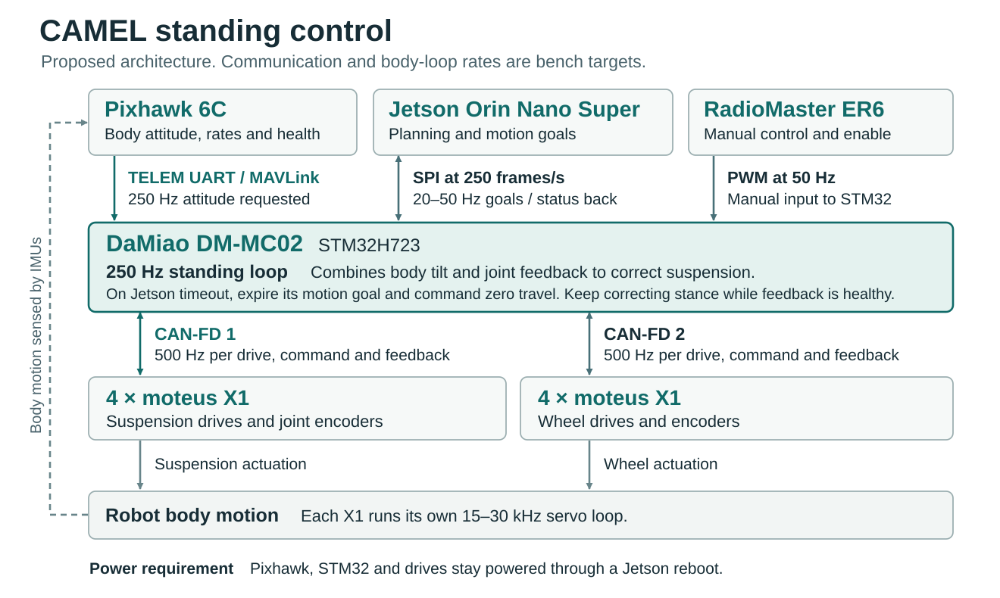

# CAMEL standing control

The proposed design puts the standing controller on the STM32. The Pixhawk measures body attitude and the suspension drives return joint feedback directly to that controller. The Jetson can request speed and height over SPI. If Linux freezes or reboots during standing, the STM32 can still observe and correct tilt, provided the Pixhawk, STM32 and drives stay powered and their feedback is healthy. This behaviour still needs a restrained hardware test.

## Who sends what

| Connection | Payload and responsibility | Proposed rate |
| --- | --- | --- |
| Pixhawk 6C TELEM2 → STM32 UART | MAVLink 2 attitude, body rates and estimator health. Check validity and the age of distinct samples at the STM32. A 6X Mini can use its TELEM port if already available. | Request 250 Hz for attitude. Measure the delivered rate and sample age. |
| Jetson ↔ STM32 | Jetson clocks the 3.3 V SPI link. It sends expiring motion goals and reads status. A repeated goal keeps its original expiry. | 250 frames/s, with new goals at 20–50 Hz. |
| Manual receiver → STM32 | PWM manual command and enable. Check receiver behaviour on radio loss. | 50 Hz when configured. |
| STM32 ↔ eight moteus X1 drives | CAN1 serves four suspension drives. CAN2 serves four wheel drives. Each X1 returns feedback and runs its own local servo. | Target 500 command/reply cycles/s per drive, at 1 Mbit/s arbitration and 5 Mbit/s data. |
| STM32 body controller | On its own timer, combine body tilt and joint feedback, compute bounded suspension corrections and command wheel travel. | 250 Hz, one tick every 4 ms, independent of SPI traffic. |

## Why this hardware

- **Pixhawk.** The 6C provides the attitude estimate and a 3.3 V TELEM UART for a direct STM32 link. The 6X offers additional sensor redundancy. The standing loop can use either board without forwarding attitude through the Jetson. [Holybro 6C ports](https://docs.holybro.com/autopilot/pixhawk-6c/pixhawk-6c-ports) · [6X Mini ports](https://docs.holybro.com/autopilot/pixhawk-baseboards/pixhawk-mini-baseboard-ports) · [PX4 MAVLink configuration](https://docs.px4.io/main/en/peripherals/mavlink_peripherals)
- **Controller.** The DaMiao DM-MC02 is a prototype candidate. Its STM32H723 has three physical CAN-FD buses with onboard transceivers. The unused LCD header exposes SPI1 clock, MISO, MOSI and a GPIO chip select. The board was listed at US$42.65 on November 19, before shipping and tax. Compared with the NUCLEO-H753ZI, it has less internal memory (1 MB flash and 564 KB RAM versus 2 MB and 1 MB) and eliminates the two external transceiver boards. Firmware still needs to implement SPI peripheral operation and the moteus protocol. [DaMiao board manual, pp. 2, 4 and 9](https://github.com/dmBots/DM-MC02/tree/master/manual) · [Supplier](https://electropeak.com/dm-mc02-stm32h723-robotic-arm-control-board-with-onboard-imu-sensor) · [H723](https://www.st.com/en/microcontrollers-microprocessors/stm32h723vg.html) · [H753](https://www.st.com/en/microcontrollers-microprocessors/stm32h753zi.html)
- **Motor buses.** The conservative wire-time calculation for 32-byte commands and 24-byte replies uses about 97% of one bus for eight drives at 500 Hz, or about 48% of each bus with four drives per bus. This estimate excludes retries and software delays. Measure reply deadlines under simultaneous load. [moteus CAN protocol](https://mjbots.github.io/moteus/protocol/can/) · [X1 drive specifications](https://mjbots.com/products/moteus-x1)

## First bench test

1. With motor outputs disabled, confirm the sign of tilt, distinct attitude timestamps and drive IDs. Exercise both motor buses while SPI frames arrive. Record fresh sample age, STM32 loop intervals and missed 2 ms drive-reply deadlines.
2. On a restrained rig in standing mode, stop Jetson traffic, then reboot the Jetson. Apply a small tilt. Verify that wheel travel goes to zero and the STM32 keeps correcting stance using fresh feedback throughout the reboot.
3. Test stale Pixhawk state and loss of suspension-drive feedback separately. Qualify a bounded fallback and deliberate re-enable before full-vehicle tests. Continued stance through a Jetson outage is conditional on healthy sensing, actuation and power.
