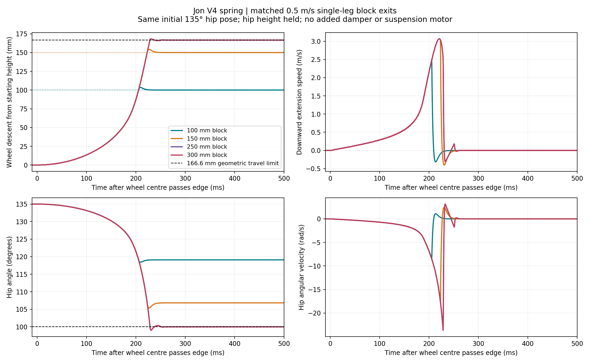

# Four-height descent with Jon's V4 spring

[Documentation home](../../README.md) · [Original single-leg study](../2026-10-18-jon-single-leg-descent/README.md) · [Simulation plan](../../design/simulation/descent-studies.md)

October 18, 2026. **Computed fixture behavior using assumed moving masses;
hardware performance and full-vehicle descent remain unverified.** The user
requested 100, 150, 250 and 300 mm block exits with the same spring setup.

The subsequent [October 19 8.75 kg / 20° baseline update](../2026-10-19-jon-baseline-descent/README.md)
uses Jon’s newer screenshot parameters and retains this earlier study unchanged
as the 13 kg / 0° reference.

At 0.5 m/s, the 100 and 150 mm cases reach the lower floor. The 250 and 300 mm
cases reach the extension stop and hang above it. The latter two have the same
relative leg trajectory because neither lower floor is within reach.



The original local actual-speed four-panel video (1080p/60 fps, two seconds).
Each frame advances simulation time by 1/60 s. All panels use the same scale and
follow horizontal carriage movement; hip height is held in each run. Two seconds
of simulation occupy two seconds of playback. No vertical path is commanded.

## Matched inputs and source

The [original study](../2026-10-18-jon-single-leg-descent/README.md#source-and-physical-inputs)
contains the complete sourced spring/geometry inputs and physical model
derivation. This study reuses that implementation and pinned Jon commit
[`e91897a9cf9bb36ff3f20afc4c92ea5315cc46b7`](https://github.com/Yulaiduan/WATERLOO-MTE-ME-CAPSTONE/commit/e91897a9cf9bb36ff3f20afc4c92ea5315cc46b7),
specifically `v4-textbook-10mm.json`, not the older 0.1 mm-idler sample.

- Two 300 mm links, ratio 2:1, zero phase/tilt; 100 mm wheel radius.
- Initial hip angle 135 degrees in every case; allowed range 100–165 degrees.
- Exact finite-idler spring: 8 N/mm, 10 mm idler, 89.416 mm horn,
  reference tension 149.918 N at 90 degrees; unchanged fitted offsets.
- Assumed femur/tibia/wheel masses 0.6/0.65/1.5 kg. No added damper,
  suspension motor, reflected rotor inertia or cable friction.
- Held-height/pitch hip and prescribed 0.5 m/s horizontal carriage, starting
  250 mm before the edge. The nominal wheel-centre edge crossing is at 0.5 s.
- Each block starts the wheel on top at the same leg pose. Hip world height is
  therefore `block height + 100 mm + 424.264 mm`; its height relative to the
  block top is matched. This is not one common absolute hip elevation.
- Identical contact/friction/soft-stop settings: 0.8 friction, 4 ms contact
  time parameter, 2 ms stop time parameter, 0.125 ms integration. Visible wheel
  cylinder retains inertia; the contact proxy has an exact circular section.

Only block height and the corresponding initial world elevation change between
the four primary runs. This keeps the initial spring state and usable remaining
extension matched. It does not change the geometry to make every floor reachable.

## Results

Times below start when the wheel centre passes the edge, not when final corner
contact is lost. Floor arrival requires more than 1 N lower-floor normal force;
CSV timing resolution is 0.5 ms.

| Block height | First floor contact after edge | Peak downward extension speed | First extension-stop crossing | Geometric gap at stop |
| --- | ---: | ---: | ---: | ---: |
| 100 mm | 205.5 ms | 2.486 m/s | None | Floor reached |
| 150 mm | 223.0 ms | 3.067 m/s | None | Floor reached |
| 250 mm | No floor contact | 3.067 m/s | 229.0 ms | 83.38 mm |
| 300 mm | No floor contact | 3.067 m/s | 229.0 ms | 133.38 mm |

Downward speed just before floor loading is 2.457 m/s at 100 mm and 3.050 m/s
at 150 mm. The 150 mm case retains about 5.37 degrees of minimum extension-stop
margin during contact compliance. The curve accelerates strongly near landing;
it is not a chosen rest-to-rest control profile.

### Why 250 and 300 mm cannot land in this fixture

On this branch, hip-to-hub vertical drop is `e(q)=2 L sin(q)`. Initially
`e(135deg)=424.264 mm`; at the extension limit `e(100deg)=590.885 mm`. Remaining
downward wheel travel is therefore **166.621 mm**. This is travel remaining
from the chosen pose, not the leg's entire range or Jon's earlier ~340 mm figure.
The gaps follow directly from `block height - remaining travel`.

A real vehicle can lower/rotate its chassis and redistribute loads among legs.
Consequently this fixture result does not establish that the vehicle cannot
descend 250/300 mm. A free-chassis test is needed to find its motion, contact
recovery and controller/motor demands. Starting with a more compressed leg
would also provide more travel, but would be a different initial condition.

MuJoCo's soft stop permits about 0.97 degrees of transient overrun in the primary
250/300 mm cases (maximum computed descent 168.31 mm). Refined cases reach about
1.03 degrees; displacement beyond the geometric limit stays below 2.5 mm.
This is numerical stop compliance, **not extra usable leg travel**. It cannot
close the 83/133 mm gaps. The small initial stop rebound is visible in the plots.
Likewise, the 3.39/4.28 mm initial floor penetration in the 100/150 mm cases is
contact compliance, not sustained travel beyond the lower floor.

## Checks and numerical sensitivity

Ten contact integrations: four primary, all four at half timestep (0.0625 ms),
and the 150/300 mm cases at half contact-time parameter (2 ms).

- All complete two seconds with finite states and no MuJoCo warnings.
- The 100 mm primary reproduces the original floor time, peak extension speed
  and peak joint speed exactly.
- Floor reachability agrees with geometry in all ten integrations.
- Halving timestep changes peak extension speed by 0.27–0.31%; floor-arrival
  times stay unchanged at reporting resolution. Stop-angle minima change by
  0.058 degrees or less for the unreachable cases.
- Halving contact time changes peak extension speed by 0.043% or less and
  preserves floor time/reachability. Contact peaks are not calibrated: the
  150 mm floor-force peak changes from 5.17 to 8.97 kN. Do not use this as an
  impact rating. Contact-related angular-speed peaks also vary by a few percent.
- Maximum loaded wheel-path horizontal error is below 7.1 micrometres and
  coupling error below 2.4e-5 rad; carriage position differs from nominal by
  less than 19 micrometres in the primary runs.
- Rechecked the retained independent wheel path, height inverse, Jacobian,
  source spring port, energy derivative, circle/box contact distance and flight
  ODE checks. Source-port error is below 5.7e-13; ideal geometry/map errors below
  1e-12. Jon's 91,128 source assertions were verified in the preceding study.
- Canonical `python3 simulation/run.py check` passes. Rendered plots and
  decoded video frames were visually inspected; video metadata verifies
  120 frames, 60 fps, 1920×1080, two seconds, no audio.

Exact metrics, sensitivity, runtime versions, model hashes, script hashes and
inputs are in [compact results](results.json). Raw CSVs, model XMLs, poses and
source snapshots are in [portable scripts and inputs](../../../users/yulai-duan/experimental-apps/block-descent-study/README.md).
Runtime: Python 3.11.16, MuJoCo 3.14.0, NumPy 2.4.6. There are no stochastic inputs.

## Reproduce

From the Capstone root, with the original pinned source snapshots present:

```sh
cd users/yulai-duan/experimental-apps/block-descent-study
python jon_single_leg_descent.py
python jon_descent_height_sweep.py
python jon_descent_height_sweep.py --render
```

Rendering and encoding require working macOS graphics/media access. Use a fresh
MP4 filename when encoding again. Cached integrations require unchanged case
parameters and matching model hashes; preserve earlier evidence when changing
the physics implementation. The new sweep imports the original experiment,
whose source snapshot is retained alongside it.

For the next descent study, carry forward both outcomes: a conditional passive
descent speed envelope for reachable floors and explicit travel exhaustion for
larger drops. Add chassis motion and measured moving inertias before converting
these results into actuator requirements or a claimed obstacle capability.
