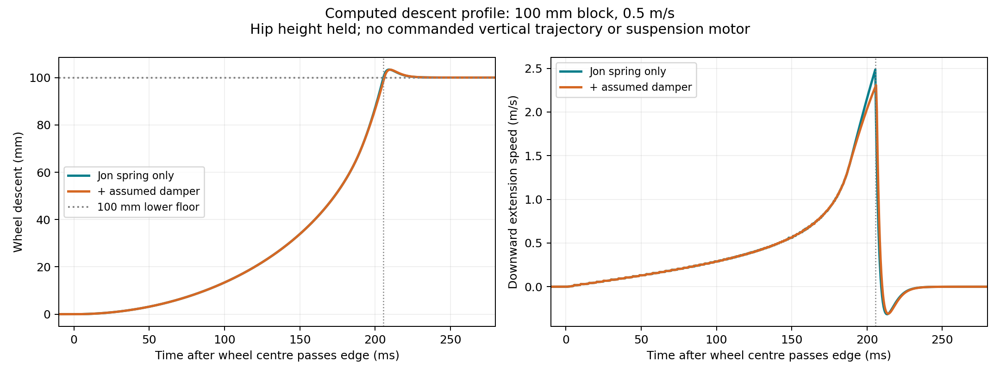

# Single-leg block descent with Jon's V4 spring

[Documentation home](../../README.md) · [Study plan](../../design/simulation/descent-studies.md)

October 18, 2026. **Computed single-leg fixture behavior with assumed masses,
not a hardware measurement, full-vehicle result or selected motor rating.**

The wheel rolls around the block corner, accelerates downward, briefly leaves
the corner and lands on the lower floor. No downward position trajectory is
commanded. In the main 100 mm / 0.5 m/s case, lower-floor contact begins about
**205.5 ms after the wheel centre passes the block edge**. Peak extension speed
is **2.486 m/s** and the pre-contact downward speed is **2.457 m/s**. The profile
is gradual initially and much faster near landing, rather than a square step or
a rest-to-rest smooth control target.



The original local actual-speed video (1080p/60 fps, two seconds)
compares the same spring alone with an illustrative damper. Both panels run at
1x, with the camera following the carriage. A drawn spring/cable is schematic;
installed spring length and packaging have not been established.

## Source and physical inputs

Pinned GitHub commit
[`e91897a9cf9bb36ff3f20afc4c92ea5315cc46b7`](https://github.com/Yulaiduan/WATERLOO-MTE-ME-CAPSTONE/commit/e91897a9cf9bb36ff3f20afc4c92ea5315cc46b7),
October 18 at 02:23 Toronto, “V4 VSL Solver (constant force pulley).” Read its
[model](https://github.com/Yulaiduan/WATERLOO-MTE-ME-CAPSTONE/blob/e91897a9cf9bb36ff3f20afc4c92ea5315cc46b7/users/jonathan-xie/experimental-apps/leg-solver/v4-model.md),
embedded numerical code and
[10 mm textbook preset](https://github.com/Yulaiduan/WATERLOO-MTE-ME-CAPSTONE/blob/e91897a9cf9bb36ff3f20afc4c92ea5315cc46b7/users/jonathan-xie/experimental-apps/leg-solver/v4-textbook-10mm.json).
The older `v4-sample-13kg-fitted.json` uses a 0.1 mm pulley and is **not** this
run's spring. Source snapshots and hashes are retained with the raw study.

| Input | Value | Evidence |
| --- | --- | --- |
| Links / angular coupling | 300/300 mm, 2:1, zero phase and mounting tilt | Jon's preset |
| Wheel radius | 100 mm | Jon's preset |
| Spring stiffness / idler radius | 8 N/mm / 10 mm | Jon's preset |
| Horn radius / pulley offsets | 89.416035166 mm / Su 7.1579230735 mm, Sv 100 mm | Jon's fitted preset |
| Horn indexing / reference tension | 0 degrees / 149.918334501 N at hypothetical 90 degrees | Jon's preset; tension is not free length |
| Allowed hip angle | 100–165 degrees; initial 135 degrees | Jon's preset; chosen initial pose |
| Hip-to-hub drop initially / on lower floor | 424.264 / about 524.279 mm | Geometry / computed contact equilibrium |
| Block / approach speed | 100 mm / 0.5 m/s primary; 0.25 and 1 m/s sensitivity | Exploratory test choices |
| Moving masses | Femur 0.6, tibia 0.65, wheel 1.5 kg | Assumptions carried from Andy's older bench, not measured CAD |
| Chassis / support reference | 13 kg held chassis; spring remains tuned to Jon's 13 kg ideal load | Fixture assumption, not a 13 kg total robot |
| Damping / motors | Base zero; comparison 1.5 N m s/rad at hip; no suspension motor or reflected rotor inertia | Illustrative addition / omission |
| Tire friction / contact time | 0.8 sliding coefficient; 4 ms contact time parameter | Assumed contact model |
| Physics / output intervals | 0.125 ms integration, 0.5 ms CSV, about 1.625 ms replay states | Numerical choices |

The spring is implemented through its exact one-coordinate potential energy:
finite tangent span plus changing pulley wrap gives cable payout `c(q)`,
`F=max(0,p0+k[c(q)-c(90deg)])` and `tau_s=-F dc/dq` in SI units. This is an
internal generalized spring torque, including the opposite chassis reaction;
there is no external gravity compensation. Mount/bearing forces are not
reconstructed. The unchanged source law is checked against the actual embedded
V4 library at 651 poses, including force, torque, energy and payout.

## Fixture and contact boundaries

The primary test holds hip height and pitch, as if supported by a carriage or
the rest of the vehicle. A high-gain horizontal velocity actuator (1e6 N s/m)
maintains the specified travel speed; it is an external laboratory fixture,
not a selected propulsion system. The wheel is free to rotate and its vertical
position follows dynamics/contact. The main-case horizontal path differs from
the nominal constant-speed path by at most **15.8 micrometres**. Frictionless
cable, rigid links, ideal coupling and no drive-belt/rotor losses are assumed.

A sphere collision proxy gives the wheel an exact circular section in the
travel plane; the visible cylindrical wheel retains its cylindrical mass and
inertia. This is suitable for this isolated 2D corner contact, not a calibrated
tire or a lateral tire model. Its box-corner signed distance was independently
checked. An initial cylindrical-contact draft and an incorrect moving-position
constraint draft were rejected and excluded; they are not study results.

Separate heave cases allow chassis vertical motion while retaining pitch and
the horizontal carriage. Keeping 13 kg chassis **and** adding moving masses
does not reproduce Jon's massless-link static balance. That diagnostic drifts
even before the obstacle and later reaches a stop; do not attribute its entire
371 mm chassis descent to the block.

For a load-matched heave diagnostic, use 12.3875 kg chassis with the same spring
and moving masses. For equal links on flat ground the effective static spring
load is `m_chassis+0.75*m_femur+0.25*m_tibia`; this restores 13 kg, with the wheel
weight supported directly by the floor. This is a deliberate test load, not an
updated project mass budget. It reaches the lower floor at 206 ms, with
2.482 m/s downward wheel speed. The undamped chassis subsequently rises about
23 mm relative to its initial height; the damped companion drifts downward about
50 mm. Constant support alone does not restore a unique ride height.

## Results and sensitivity

| Held-height case | First lower-floor contact after edge (ms) | Peak extension speed (m/s) | Peak hip speed magnitude (rad/s) |
| --- | ---: | ---: | ---: |
| 0.25 m/s, spring only | 404.5 | 1.995 | 6.829 |
| **0.5 m/s, spring only** | **205.5** | **2.486** | **8.520** |
| 1.0 m/s, spring only | 107.5 | 3.039 | 10.437 |
| 0.5 m/s, added illustrative damping | 206.5 | 2.307 | 7.891 |
| 0.5 m/s, half moving masses | 204.0 | 3.071 | 10.512 |
| 0.5 m/s, double moving masses | 208.5 | 2.042 | 6.991 |

The primary wheel descends 10/50/90 mm at approximately 87.5/173.5/201.5 ms
after centre passage. It follows the circular corner for most of the descent;
the final short flight is roughly 18–20 ms in the base/timestep/contact
variants. The 1 N contact threshold chatters briefly near the rigid corner,
so a precise contact-loss duration is less robust than floor-arrival timing.
The small post-contact overshoot is contact compliance, not extra useful travel.

Halving timestep changes peak extension speed from 2.486 to 2.494 m/s
(0.31%) and leaves floor-arrival time unchanged at the 0.5 ms reporting interval.
Halving the contact-time parameter gives 2.489 m/s and the same arrival time.
However, peak lower-floor normal force changes from approximately **3.03 to
5.88 kN** with that contact change. It is an uncalibrated, stiffness-sensitive
solver result and is **not an impact load rating**. Eleven integrations remain
finite without physics warnings. Held-height cases retain over 18 degrees of
extension-stop margin.

## Verification and reproduction

- Actual pinned `verify-pulley.cjs`: **91,128 assertions pass**.
- Independent wheel path, inverse height and Jacobian checks: errors below
  1e-12 in SI units; source spring port maximum numeric discrepancy 5.69e-13.
- Spring torque versus energy derivative: maximum discrepancy 2.52e-8 N m.
- Independent circle/box contact-distance discrepancy: 2.36e-16 m.
- Independent airborne Euler–Lagrange equation integrated by 1 microsecond
  RK4 agrees with MuJoCo within 5.42e-5 rad over 20 ms at a 31.25 microsecond
  MuJoCo check step. Instantaneous acceleration differs by 0.0805%, consistent
  with the finite-impedance joint coupling, rather than an exact rigid constraint.
- Canonical `python3 simulation/run.py check` passes. Rendered poses and decoded
  MP4 frames were visually inspected. Video metadata confirms 120 frames,
  60 fps, 1920×1080, two seconds and no audio; each frame advances time by 1/60 s.

Environment: project Python 3.11.16, MuJoCo 3.14.0 and NumPy; exact versions,
source/model hashes, configs, CSVs and poses are in
[portable scripts and inputs](../../../users/yulai-duan/experimental-apps/block-descent-study/README.md).
[Compact results and provenance](results.json) are retained beside this record.
No random terrain or stochastic inputs were used.

From the Capstone root:

```sh
cd users/yulai-duan/experimental-apps/block-descent-study
node jon_descent_source_reference.cjs
python jon_single_leg_descent.py --check
python jon_single_leg_descent.py
python jon_single_leg_descent.py --render
```

Source snapshots must be present before exporting the reference. Rendering and
AVFoundation encoding need working macOS graphics/media access. The encoder
requires a fresh output filename. Existing run caches are reused only with
matching case parameters and model hash; preserve old runs when changing inputs.

## What to use next

The user-requested [four-height follow-up](../2026-10-18-jon-descent-heights/README.md)
preserves this baseline and adds 150, 250 and 300 mm blocks. It identifies travel
exhaustion at 250/300 mm with the held-height hip, rather than artificially
extending the leg to reach every floor.

Use this computed position/speed envelope as a first conditional answer to
Andy's profile question. Fit or measure moving inertias, friction, damping,
tire compliance and actual spring stroke before treating the values as hardware
predictions. Add the actual motor/transmission inertia, torque-speed/current
limits, backdrive and regenerative behavior before sizing a motor. Then test a
bounded height/contact-recovery controller and free full-vehicle load sharing.
Do not replace the measured trajectory with a chosen smooth curve and call the
result passive dynamics.
