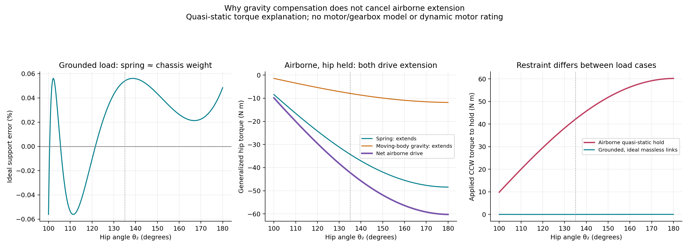
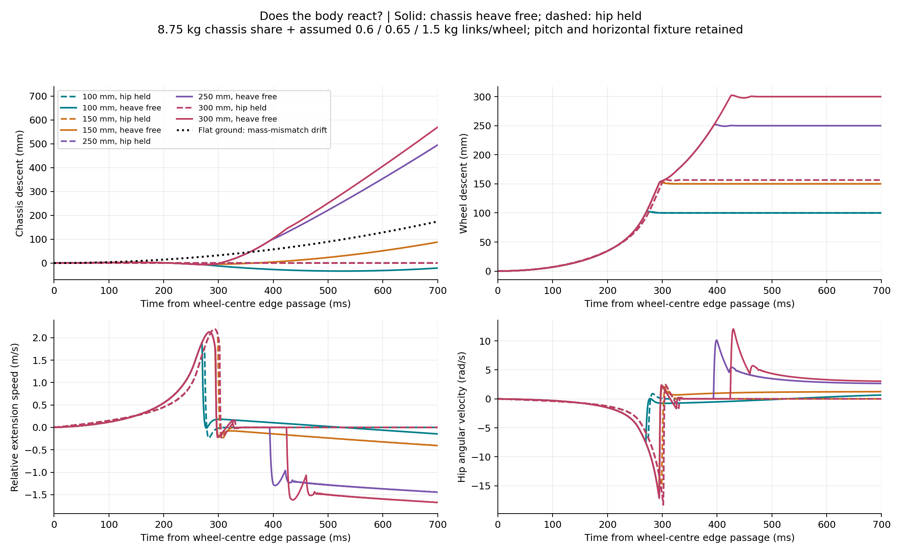
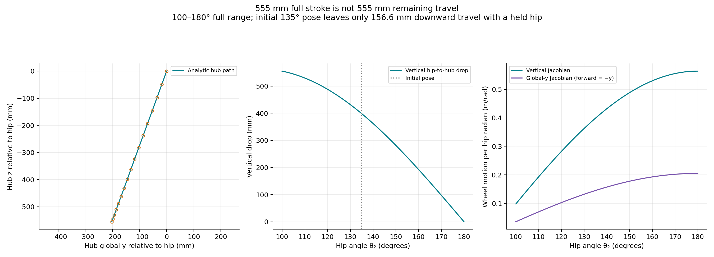
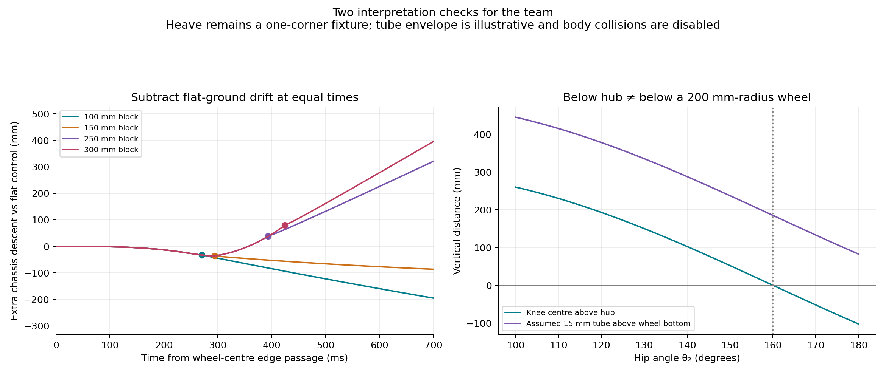

# Jon’s 8.75 kg / 20° baseline: block descent

[Documentation home](../../README.md) · [Benchmark index](../README.md) · [Earlier four-height study](../2026-10-18-jon-descent-heights/README.md) · [Descent discussion](../../design/simulation/obstacle-profile.md)

October 19, 2026. **Computed one-leg fixture results with assumed moving masses,
not hardware measurements or full-vehicle performance.** This requested update
uses Jonathan’s new screenshot settings and reruns 100, 150, 250 and 300 mm block
exits. Earlier studies remain intact.

At 0.5 m/s forward, the held-hip leg reaches the floor after **275 ms for a
100 mm block** and **299 ms for 150 mm**. It cannot reach 250/300 mm floors from
the initial 135° pose: the remaining vertical travel is **156.572 mm**. When
chassis heave is allowed, all four floors are reached, but body motion and stop
hits become part of the response. Static gravity compensation does not remove
airborne spring-driven motion or establish a stable ride height.

## Plots to bring to Andy and Jon

1. **Extension profile and joint speed:** how the wheel descends, when the floor
   is reached, and what happens at the travel limit.

   

2. **Grounded versus airborne torque:** the spring approximately compensates
   8.75 kg in the grounded, massless-link load case. With an airborne wheel and
   held hip, moving-body gravity and the spring both drive extension. At 135°,
   the spring supplies −34.240 N m and gravity supplies −7.915 N m in the
   generalized coordinate. A quasi-static hold would need **+42.155 N m CCW**.
   This is a holding-torque explanation, not the dynamic torque required to
   execute a particular descent. The passive runs have **zero suspension-motor
   torque**. Restraining extension absorbs energy; actual drive/brake demands
   still depend on a chosen trajectory, gearing, inertia and controller.

   

3. **Chassis reaction:** solid lines allow heave; dashed lines hold the hip.
   Downward wheel movement equals body descent plus relative leg extension.
   Relative extension can reverse after landing; there is no ride-height
   controller or added damper in these runs.

   

4. **Available stroke and joint sensitivity:** the 555.250 mm figure spans
   100–180°. Starting at 135° already uses most of that extension. The checked
   wheel path, inverse height map and Jacobians are retained here.

   

5. **Interpretation controls:** a flat-ground run measures the drift caused by
   adding finite moving masses to a massless-link spring fit. The left plot
   subtracts this control at equal elapsed times; it is a paired counterfactual,
   not a linear decomposition of nonlinear dynamics. The right plot checks
   Jon’s knee-below-hub observation: that happens above 160°, but the assumed
   15 mm tube still remains at least about 82 mm above the bottom of a
   200 mm-radius wheel on level ground. This is a geometric screen, not CAD,
   packaging or obstacle-clearance validation.

   

All five figures are also available as vector PDFs in the
[figure folder](assets/).

## Source and matched inputs

[Jonathan’s October 19 21:57 baseline post](https://discord.com/channels/1527561241831276715/1558281627170381885/1561921319518609450)
and [22:29 travel clarification](https://discord.com/channels/1527561241831276715/1558281627170381885/1561929232362381413).
The full-resolution screenshot remains in the author's local evidence and is not published here. The numerical [source inputs](../../../users/yulai-duan/experimental-apps/block-descent-study/inputs/README.md) are included.
Its numerical settings were transcribed; no new complete JSON preset was
posted in this message. The saved `screenshot-baseline.json` records this origin.

| Input | New baseline | Source/status |
| --- | ---: | --- |
| Supported chassis share | 8.75 kg | Jon’s 35 kg chassis divided by four |
| Femur/tibia length; angular coupling | 300/300 mm; 2:1, zero phase | Post and established V4 geometry |
| Mount angle; forward direction | 20°; −global y | Screenshot; explicit front/travel label |
| Wheel radius | 200 mm | Screenshot and 22:30 clarification |
| Spring rate; pulley radius | 5 N/mm; 10 mm | Screenshot |
| Horn radius | 90.350954 mm | Screenshot, displayed to six decimals |
| Pulley offsets Su/Sv; horn indexing | 6.99890652166 / 100 mm; 0° | Screenshot |
| Reference tension at hypothetical 90° | 90.6633100698 N | Screenshot; not free length or installed length |
| Angular limits; chosen starting pose | 100–180°; 135° | Screenshot range; retained comparison pose |
| Moving femur/tibia/wheel masses | 0.6/0.65/1.5 kg | Assumptions from the prior study, additional to the chassis share |
| Forward speed; duration | 0.5 m/s; 1 s | Test choices |
| Time origin | Wheel centre over block edge | Same initial zero heave/joint speeds in both fixtures |
| Integration; output spacing | 0.125 ms; 0.5 ms | Numerical choices |
| Tire/stop response times; friction | 4 ms / 2 ms; 0.8 | Uncalibrated contact/stop assumptions |

The source equations remain pinned to V4 commit
[`e91897a9cf9bb36ff3f20afc4c92ea5315cc46b7`](https://github.com/Yulaiduan/WATERLOO-MTE-ME-CAPSTONE/commit/e91897a9cf9bb36ff3f20afc4c92ea5315cc46b7).
The spring port is checked against its actual embedded library at 801 poses
with the new parameters. Reproduced ideal support error is **±0.05616%**, matching
the screenshot’s approximately ±0.05615% after rounding. This numerical fit is
not a physical spring-accuracy claim.

The world x coordinate in the code represents Jon’s global y; therefore forward
speed is **−0.5 m/s** and the block occupies positive global y. The mount rotates
the local u/v frame clockwise by 20°. Reverse-travel drafts are excluded from
these results. The earlier study used a 100 mm-radius wheel, a different spring,
zero mount angle, a 165° compression stop and an approach segment. Consequently
the old/new time difference cannot be attributed to mass or alpha alone.

## Held-hip results

| Block | First floor loading after edge | Downward speed before loading | Peak extension speed | Peak absolute hip speed | Geometric gap at extension stop |
| --- | ---: | ---: | ---: | ---: | ---: |
| 100 mm | 275.0 ms | 1.776 m/s | 1.776 m/s | 6.736 rad/s | Reaches floor |
| 150 mm | 299.0 ms | 2.079 m/s | 2.194 m/s | 15.681 rad/s | Reaches floor |
| 250 mm | No contact | — | 2.194 m/s | 18.280 rad/s | 93.428 mm |
| 300 mm | No contact | — | 2.194 m/s | 18.280 rad/s | 143.428 mm |

The 250/300 mm trajectories overlap because the lower floor does not act on
either wheel. Both first cross the 100° extension limit at **302.5 ms**. Soft
stops allow a transient overrun down to 99.239°; it is numerical compliance,
not additional usable stroke. The 150 mm landing retains about 2.02° minimum
stop margin, and the joint-speed peak is greater than in the 100 mm case.

All peaks in this table are maxima over the one-second run. Contact/rebound can
make peak extension speed differ from the speed immediately before first loading.
Contact force greater than 1 N defines first floor loading; reporting resolution
is 0.5 ms. First loading does not mean settled contact or recovery of ride height.

## Heave-free diagnostic

The chassis has a vertical degree of freedom with mass **8.75 kg**, while pitch
and horizontal carriage motion remain constrained. This is one isolated corner,
not four interacting legs. The initial wheel position, pose and velocities match
the held-hip cases. No vertical fixture or motor is released later in the run.

| Block | First floor loading | Downward wheel speed before loading | Chassis descent at first loading | Extra relative extension at first loading |
| --- | ---: | ---: | ---: | ---: |
| 100 mm | 270.5 ms | 1.844 m/s | −6.49 mm (body rises) | 107.21 mm |
| 150 mm | 294.0 ms | 2.058 m/s | −4.90 mm (body rises) | 155.21 mm |
| 250 mm | 393.5 ms | 1.473 m/s | 93.44 mm | 156.58 mm |
| 300 mm | 424.5 ms | 1.777 m/s | 143.97 mm | 156.55 mm |

The large drops first hit the extension stop around **295 ms**; chassis descent
then supplies the remaining reach. The 150 mm heave case also crosses the stop
after first landing. Reaching the floor therefore does not establish acceptable
ride response, stop loading or actuator feasibility. Small deviations from exact
block height in the last two columns include tire/stop compliance.

**Do not attribute all subsequent body motion to the block.** Jon’s fit sets
moving masses to zero. Adding the assumed link/wheel masses makes the physical
fixture a different load case. At 135°, the links add approximately **0.726 kg
of effective static support load**; the wheel’s own weight is floor-supported
on flat ground. The retained no-block heave control sinks **352.4 mm over 1 s**.
The largest block runs sink further and substantially compress after landing.
No restoring ride-height law, damping or other-leg support is present. These
diagnostics demonstrate a dependency to resolve with Jon and Ali, rather than
predicting a full vehicle’s chassis drop.

## Geometry, force convention and limits

For q = θ₂ in radians and alpha = 20°, the hub relative to the hip is

```text
y = −2 L sin(q) sin(alpha)
z = −2 L sin(q) cos(alpha)
vertical drop e = −z;  q = pi − asin(e / [2 L cos(alpha)])
Jz = dz/dq = −2 L cos(q) cos(alpha)
Jy = dy/dq = −2 L cos(q) sin(alpha)
```

Thus q decreasing means extension on this branch. From 135° to 100° the extra
vertical reach is 156.572 mm, compared with 555.250 mm from 180° to 100°.
For the opposite mirrored mount, the horizontal component changes sign while
the vertical map is unchanged. Both mounting signs are checked kinematically;
the dynamic cases here use Jon’s selected forward orientation.

The finite-pulley spring uses tangent span plus changing wrap, with unilateral
tension `F=max(0,p0+k[c(q)−c(90°)])` and generalized torque `tauS=−F dc/dq`.
It acts internally between leg and chassis; the heave reactions are produced
by the articulated-body dynamics. No artificial upward support force is added.
The quasi-static grounded comparison uses massless links; the airborne holding
curve includes the assumed moving-body gravity with a held hip.

No suspension motor, gear train, rotor inertia, spring/cable hysteresis, measured
damping, finite cable stretch or spring packaging is included. Horizontal drive
uses the retained high-gain velocity fixture, which can exchange energy with
the inclined leg through contact; it is not a selected propulsion system.
The tire uses an exact circular-section sphere proxy with cylinder mass/inertia.
Only tire-terrain collisions are enabled. Chassis/link/cable clearance therefore
still needs actual CAD and collision checks. CAD masses and physical stops are
unavailable. No random inputs or terrain seeds are used.

## Verification and reproduction

**22 integrations:** four heights × held/heave fixtures, all eight repeated at
half timestep, 150/300 mm in both fixtures repeated at half contact-response
time, plus the flat-ground control at both timesteps. All finish with finite
states and no MuJoCo warnings.

- Analytic versus MuJoCo wheel path/Jacobian errors below 3.4e−16 m and m/rad;
  forward/inverse height error below 2.3e−15 rad. Mirror signs checked.
- Actual embedded V4 spring versus Python port: maximum discrepancy 4.55e−13
  across force, torque, energy and payout comparisons (respective units).
- Spring torque versus energy derivative error below 2.95e−8 N m; independent
  circle/box contact distance error below 8.4e−17 m.
- Independent rigid-coupling airborne ODE: initial acceleration agrees within
  0.069%; a 20 ms integration differs by 3.62e−5 rad at 31.25 microsecond
  MuJoCo timestep. The equality coupling has finite impedance.
- Loaded path error below 9.41 micrometres and coupling error below 3.14e−5 rad.
  Horizontal carriage error below 14.5 micrometres in the primary cases.
- Halving timestep changes peak extension speed by less than 0.176%; first
  landing times are unchanged at 0.5 ms resolution. Halving contact time changes
  peak extension speed by less than 0.065% and preserves first landing times.
- Floor-force peaks change by roughly **61–86%** in the selected contact-time
  refinements. They are not calibrated impact ratings and are not promoted as
  hardware loads. Total contact-loss duration also depends on rigid-edge chatter.
- Canonical `python3 simulation/run.py check` passes. All five plotted figures
  and a native MuJoCo offscreen model view were visually inspected.

Exact inputs, runtime versions, raw model XMLs, CSVs, code/source hashes and
sensitivity metrics are in [portable scripts and inputs](../../../users/yulai-duan/experimental-apps/block-descent-study/README.md)
and [compact results](results.json). Runtime is Python 3.11.16, MuJoCo 3.14.0,
NumPy 2.4.6. Run from the Capstone root:

```sh
cd users/yulai-duan/experimental-apps/block-descent-study
python jon_baseline_descent.py
```

The batch command uses the app's pinned V4 inputs and Node.js on PATH. It preserves cached runs only for matching case,
model, spring and dynamics signatures; preserve old folders before changing
physical inputs. The source screenshot remains local; public reproduction uses its transcribed parameter file.

## Useful next conversation

- **Jon:** should the 8.75 kg fit include the link/wheel mass model, and what
  starting ride height and physical stops should all analyses use?
- **Andy:** which candidate drive/brake and reflected inertia should be tested
  against the passive hip-speed envelope? Define a descent/braking target before
  converting the holding-torque curve into a motor requirement.
- **Yulai/Ali:** add CAD masses and collision geometry, then test the four-leg
  chassis with pitch/load redistribution. The large-drop heave diagnostics are
  not safe full-vehicle descent demonstrations.

No messages or reactions were sent to Discord; this is a local simulation and
plot deliverable, not a team decision or hardware selection.
