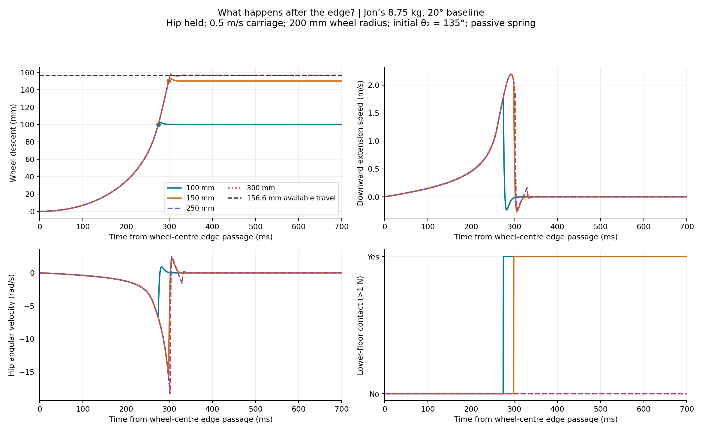

# Block-descent study batch

Yulai Duan with Codex. Studies: October 18–19, 2026; shared October 20.
Status: experimental single-leg simulation and analytical screening. The results
are not a selected vehicle design, measured hardware performance or motor rating.

## Start with the current baseline

[Jon's 8.75 kg / 20° study](../../benchmarks/2026-10-19-jon-baseline-descent/README.md)
uses the new 200 mm-radius wheel and fitted 5 N/mm spring. Its 22 integrations
compare four block heights, hip-held/heave-free fixtures, a flat-ground control,
and timestep/contact refinements. All figures are available as PNG and vector PDF.

With the hip held and 0.5 m/s forward travel, 100/150 mm drops reach the floor
at 275/299 ms, moving downward at 1.78/2.08 m/s before loading. The 250/300 mm
floors remain 93/143 mm out of reach from the initial 135° pose. The remaining
vertical leg travel is 156.6 mm, rather than the 555 mm full-stroke figure.

The most useful discussion figures are:

- [Grounded versus airborne torque](../../benchmarks/2026-10-19-jon-baseline-descent/assets/03-grounded-versus-airborne.png): grounded gravity compensation does not cancel airborne extension. At 135°, the held-hip quasi-static airborne holding torque is +42.155 N m; no dynamic motor requirement is inferred.
- [Body reaction](../../benchmarks/2026-10-19-jon-baseline-descent/assets/02-chassis-reaction.png): allowing heave changes wheel contact and ride motion; a flat-ground control identifies finite-mass drift.
- [Geometry and Jacobian](../../benchmarks/2026-10-19-jon-baseline-descent/assets/04-geometry-and-travel.png): starting pose, usable stroke, coordinate mapping and motion sensitivity.
- [Drift and knee clearance](../../benchmarks/2026-10-19-jon-baseline-descent/assets/05-drift-and-clearance.png): distinguishes body drift from a paired block response and below-hub geometry from below-wheel clearance.

## What hip held and heave free mean

**Hip held:** the chassis attachment moves forward on a horizontal rail at fixed
height. The hip joint can rotate; its angle is not locked. Downward wheel movement
must come from relative leg extension.

**Heave free:** the chassis attachment may also move vertically, while pitch
and forward velocity remain constrained. This is one corner, not a free four-leg
vehicle. Wheel descent is the sum of chassis descent and extra relative extension.

For the 250 mm drop, the held-hip leg runs out of travel at about 157 mm. Allowing
about 93 mm of chassis descent moves the hip closer to the lower floor and lets
the wheel touch it. That is what **chassis movement can recover contact** means.
It does not mean settled ride-height recovery or a gentle landing. The large-drop
heave cases hit the extension stop before the floor; the added assumed masses
also cause flat-ground drift with the unretuned spring fit.

The two fixtures answer different questions. Hip held isolates the mechanism;
heave free exposes body response. Their results do not establish a better robot
design. Contact timing, landing speed, body disturbance, stop contact and braking
demand must be assessed together.

## Earlier studies retained in this batch

| Study | Scope | Main conditional result |
| --- | --- | --- |
| [October 18 single-leg fixture](../../benchmarks/2026-10-18-jon-single-leg-descent/README.md) | 13 kg/0°/100 mm wheel; eleven integrations | 100 mm floor reached after 205.5 ms, about 2.46 m/s downward |
| [October 18 four-height sweep](../../benchmarks/2026-10-18-jon-descent-heights/README.md) | Same older baseline; ten integrations | 100/150 mm reached, 250/300 mm exceed held-hip stroke |
| [October 19 profile screening](obstacle-profile.md) | Analytical 100 mm wheel/step, quintic reference | A particular 0.20 s quintic overlaps the block; its geometry bound is 0.3681 s |
| [October 19 new-baseline comparison](../../benchmarks/2026-10-19-jon-baseline-descent/README.md) | New 8.75 kg/20°/200 mm wheel; 22 integrations | Extension, reaction, reach and holding-torque distinctions above |

Different wheel radii, springs, travel limits and initialization mean the old/new
timing differences cannot be assigned to mass or mount angle alone.

## Reproduction and evidence

Use the [portable member study app](../../../users/yulai-duan/experimental-apps/block-descent-study/README.md).
It includes source, dependencies, pinned input snapshots and publication checks.
Curated figures and original compact results are tracked here; raw CSVs, videos,
caches, logs and private Discord screenshots remain local. The app writes only
to its ignored results folder. No shared simulation runtime or robot assets change.

Before sharing, all **43 contact integrations** and the analytical profile checks
were rerun from the portable layout and compared with the retained study results.
Canonical-robot physics validation is not applicable to this isolated research
publication; no approved robot baseline is substituted by these fixtures.

## Next study

Obtain CAD masses/inertias and physical stops; resolve whether the fitted support
load includes the moving links. Define acceptable landing speed and body motion,
then compare a bounded damping/braking controller with the actual candidate
motor/transmission limits and reflected inertia. Test four-leg load sharing and
pitch before inferring vehicle capability. None of those follow-ups has been run
in this batch.
