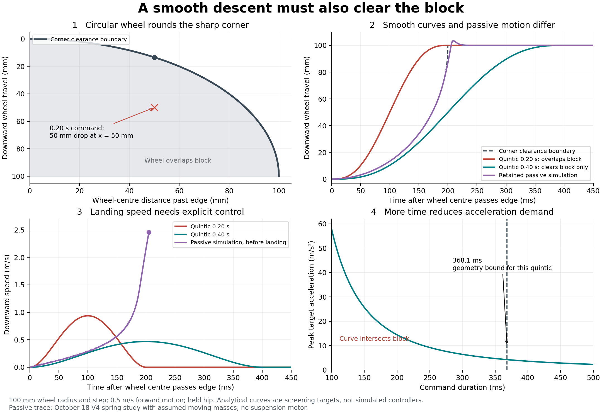

# What is an appropriate leg profile over a square obstacle?

[Documentation home](../../README.md) · [Descent study plan](descent-studies.md) · [Passive single-leg benchmark](../../benchmarks/2026-10-18-jon-single-leg-descent/README.md)

October 19, 2026. **Analytical continuation of the October 18 research.** New
results below are geometry and trajectory calculations using the existing
100 mm-wheel / 100 mm-step / 0.5 m/s held-hip case. The passive trace is reused
from the retained benchmark; no new dynamics run, controller implementation or
hardware measurement is claimed.

**Subsequent dynamics update:** the requested [8.75 kg / 20° baseline study](../../benchmarks/2026-10-19-jon-baseline-descent/README.md)
now uses Jon’s new 200 mm wheel and 5 N/mm finite-pulley fit. Its five plots
separate passive extension/joint speed, grounded versus airborne torque, chassis
heave, remaining travel and flat-ground drift. Those new inputs differ from the
100 mm-wheel analytical examples below; their numerical timing bounds are not
interchangeable. No suspension motor/controller is included in the new passive runs.

The user's question asks what replaces an impossible square response, whether
ascent is acceptable through backdriving, and what descent profile should inform
motor/gearbox selection. The practical answer is to retain the square obstacle
as physical geometry, calculate contact and flight, and use a bounded smooth
command only where it is consistent with that geometry. Recovery time, landing
speed and travel margin must be specified together.



## Clarify what the square waveform represents

- A square **displacement** command requires a position jump, hence unbounded
  speed and still more singular acceleration. A massive wheel cannot execute it.
- A square **force** or torque command can produce finite acceleration in a
  finite-inertia system, although its abrupt edges imply abrupt acceleration
  changes in a simple ideal model. Hardware also limits torque/current slew.
- A true force **impulse** is the time integral of force, in N s, and changes
  momentum. Ideal impact models can jump velocity while position stays continuous.
- A square **terrain cross-section** is legitimate geometry. It does not command
  the wheel centre to follow the terrain height discontinuity.

The wheel has finite radius. On ascent it contacts the face/corner, can suffer
an impact and then climb a curved path, deform its tire, slow, or lift/pitch the
chassis. Backdrivability cannot make an instantaneous displacement feasible.
On descent, the spring can extend the leg, but contact forces cannot pull the
wheel down toward the ground. Contact can be lost and regained.

## New result: a smooth curve can still go through the block

Let downward wheel-centre travel from its initial position be `d >= 0`, block
height `h`, wheel radius `R`, forward speed `v`, and time zero the instant the
wheel centre is directly over the upper corner. Hold hip height and the wheel's
relative horizontal path, with `x=v*t` measured forward from that corner.

For the upper-corner segment, circular-wheel nonpenetration requires

```text
d(t) <= R - sqrt(R^2 - (v*t)^2),       0 <= v*t <= R
```

The equality describes a wheel touching the corner; smaller `d` means clearance
above it. For the case `h=R=0.100 m`, a centre constrained to corner contact would
reach lower-floor height at `R/v=0.200 s`. That geometric path has an unbounded
downward slope at its endpoint. Finite forces cannot maintain it all the way;
detachment/contact compliance must resolve the motion. Its acceleration demand
on the open segment is `R^2*v^2/[R^2-(v*t)^2]^(3/2)`. This is geometry, not a
claim that corner contact persists to 200 ms.

For a rest-to-rest quintic command beginning at the edge,

```text
d(t) = h*s(t/T)
s(u) = 10*u^3 - 15*u^4 + 6*u^5,       0 <= u <= 1
```

the often-used **100 mm in 0.20 s** example is smooth but intersects this block.
At 100 ms, `x=50 mm`: circular clearance permits at most **13.397 mm** of drop,
while that quintic requests **50 mm**. A 0.30 s quintic also intersects it.

For this exact edge-start command, `h <= R`, and fixed forward speed, one can
invert the circle condition at every requested drop:

```text
T >= max over 0<u<=1 of sqrt(2*R*h*s(u) - [h*s(u)]^2)/(v*u)
```

At `h=R=100 mm` and `v=0.5 m/s`, the maximum is
**T_geometry = 0.368132732 s**, attained near `u=0.350645`.
For `h=R`, this scales as `T_geometry = 1.84066366*R/v`.
This is **only the bound for this particular quintic starting at the edge**;
it is not a minimum passive descent time or a universal response requirement.
Other trajectories, a delayed start, varying forward speed, tire deformation,
chassis motion and different initial conditions change the calculation. For
`h>R`, the corner-to-side/flight geometry needs a separate treatment; do not
extend this formula past its stated domain.

The 0.40 s candidate clears the rigid block and has zero endpoint velocity and
acceleration. It spends time above the terrain, requiring support/braking from
the actuator to oppose the extending spring. Collision clearance alone does
not prove achievable torque, stable contact, small chassis disturbance or
adequate sensing. The 0.368 s boundary allows intermediate tangency, whereas a
real command needs clearance margin and physical contact handling.

## Compare commands with the existing passive response

| 100 mm quintic duration | Peak wheel speed | Peak wheel acceleration | Peak hip speed, mapped through this leg | Clears this block geometrically? |
| --- | ---: | ---: | ---: | --- |
| 0.10 s | 1.875 m/s | 57.735 m/s² | 5.176 rad/s | No |
| 0.20 s | 0.9375 m/s | 14.434 m/s² | 2.588 rad/s | No |
| 0.30 s | 0.625 m/s | 6.415 m/s² | 1.725 rad/s | No |
| 0.40 s | 0.46875 m/s | 3.608 m/s² | 1.294 rad/s | Yes; dynamics untested |

Hip-speed entries are calculated target demands, using 300 mm equal links,
2:1 coupling, zero mounting tilt and initial Jon hip angle 135 degrees. They
are not simulated motor performance. Maxima need not occur at the same time.

The existing passive case reaches the floor **205.5 ms** after centre passage,
with **2.457 m/s** downward speed just before floor loading and **2.486 m/s**
peak extension speed. Its maximum absolute hip speed is **8.520 rad/s**. The
wheel follows the corner for most of the descent and has a final short flight;
205.5 ms is not the airborne duration. These results are conditional on the
retained spring, assumed moving masses, held hip and horizontal carriage.

The passive response's high late speed explains why a symmetric smooth command
is not a description of what the spring naturally does. The 0.40 s curve is a
candidate for an actively controlled comparison, rather than a fit presented
as passive dynamics. The undamped passive result does not establish a preferred
landing speed or acceptable impact load.

## Choose time from constraints, then check dynamic feasibility

For the quintic, analytical peak demands are

```text
v_peak = 1.875*h/T
a_peak = (10/sqrt(3))*h/T^2
j_peak = 60*h/T^3
```

If specified wheel-coordinate limits are `v_lim`, `a_lim` and `j_lim`, an initial
screen is

```text
T >= max(T_geometry,
         1.875*h/v_lim,
         sqrt((10/sqrt(3))*h/a_lim),
         (60*h/j_lim)^(1/3))
```

These scalar limits do not replace joint/motor dynamics, force/contact checks
or travel bounds. A quintic has continuous acceleration but finite jumps in
jerk at its joins to a stationary hold. Use a suitable S-curve when explicit
jerk limits are the design interface; recheck its own geometry and timing.
Northwestern's [trajectory-generation reference](https://modernrobotics.northwestern.edu/nu-gm-book-resource/9-1-and-9-2-point-to-point-trajectories-part-2-of-2/)
explains the distinctions between quintic, trapezoidal and S-curve timing.

For the retained ideal leg, with Jon's hip angle `q` in radians,

```text
e(q) = 2*L*sin(q),      J(q) = 2*L*cos(q)
q_dot = e_dot/J
q_ddot = [e_ddot + 2*L*sin(q)*q_dot^2]/J
```

Here `e` is downward hip-to-hub separation; `d=e-e_initial` only with the held
hip. Wheel world motion also contains chassis heave/rotation in a vehicle.
Near `J=0`, wheel-to-joint demand becomes poorly conditioned. For a motor/hip
reduction `G=omega_motor/q_dot`, motor speed is `G*q_dot`, and rotor inertia
reflected to the hip is `G^2*J_rotor`. Consequently changing gearing changes
the passive response itself. Multiplying the motor-free trace by a gear ratio
only screens speed; it does not predict the geared descent.

Include spring torque, gravity and moving-link inertia, friction, actuator
torque-speed/current limits, supply voltage and braking energy. Reuse the
[plan's motor handoff](descent-studies.md#next-study), including
simultaneous torque-speed points and a declared thermal duty cycle.

Travel comes before timing: from the 135-degree initial pose to the 100-degree
extension stop, only **166.621 mm** remains. The retained 250/300 mm held-hip
cases cannot reach the floor regardless of chosen time profile. A free chassis
or changed starting pose is a different physical case.

## Backdriving and the next controlled comparison

Low back-EMF alone is not sufficient. For consistent electrical conventions,
`E=k_e*omega_motor`; induced voltage is one constraint. Gear friction, rotor
inertia, generated/braking current, controller mode and supply energy absorption
also matter. Maxon's [generator guide](https://support.maxongroup.com/hc/en-us/articles/360004496254-maxon-Motors-as-Generators)
separates voltage, current and torque; its [controller guide](https://www.maxongroup.com/en-us/knowledge-and-support/blog/id-1-q-vs-4-q-controllers-21876)
explains regulated braking and possible return of energy to the supply.

The recommended next dynamics comparison has four phases:

1. **Loaded corner following:** compliant force/impedance behavior while contact
   carries load; monitor actual wheel/chassis state and available extension.
2. **Contact loss and extension:** extend within bounded speed and torque;
   estimate the floor/gap instead of requiring a fixed time trace blindly.
3. **Approach and braking:** reduce speed before touchdown. A local first
   stopping-distance screen is `distance >= speed^2/(2*a_brake)` for a declared
   available net deceleration; spring/gravity load and delay reduce the margin.
4. **Recontact and settling:** ramp support and damp motion to limit bounce and
   chassis disturbance; retain torque and travel limits.

Compare spring-only behavior, the illustrative damper and a bounded controller
with the same spring, masses, geometry and terrain. Test whether any chosen
target is achievable under the actual motor/controller limits. Report contact
loss, touchdown velocity, ride disturbance, signed power/current duty and stop
margin together. Neither 0.20 s nor 0.40 s is an accepted team requirement.

## Practical hardware route — October 19 follow-up

Established hardware addresses this class of problem through rebound damping
and torque-controlled compliance. This does not mean a completed CAMEL solution
has been built or demonstrated. The quintic above is a reference trajectory;
an encoder/feedback loop and a capable actuator are needed to track it.

The closest everyday analogy is a mountain-bike suspension extending after a
bump or into a dip. [RockShox's tuning guide](https://www.sram.com/en/rockshox/learn/suspension-fine-tuning)
explains that rebound damping controls extension speed. Too little permits
rapid return/bounce; too much prevents timely recovery and can reduce ground
contact. Apply this tradeoff to CAMEL rather than assuming that slower extension
is always better. Bicycle spring laws and geometry do not directly size our
constant-force leg or establish an interchangeable part.

For CAMEL, the recommended prototype sequence is:

1. Retain Jon's spring mechanism and measure the actual leg's force, moving
   inertia, friction and available stroke. Add a joint encoder and measure
   touchdown/contact, initially with an instrumented floor/load cell.
2. Compare spring only with an adjustable damper, coupled mechanically across
   the suspension coordinate. A rotary damper at the hip or a linear damper
   linked to that motion can provide damping without changing the intended
   static spring support, apart from real seal friction. Select force/torque,
   stroke, speed and energy ratings only after mapping its motion ratio.
3. Add current/torque-controlled motor damping if needed. An initial law is
   `tau_motor = -b*q_dot`, with saturation, so ideal mechanical motor power is
   `-b*q_dot^2 <= 0`. This is a proposed velocity-opposing torque law, not a
   tuned gain or a guarantee of gentle touchdown. Adaptive/contact-aware gains
   can follow after the bounded baseline is measured.
4. Add ride-height/attitude feedback and landing-speed control. Encoder velocity
   alone supports damping but does not reveal how far away an unknown floor is;
   pre-touchdown braking toward a particular landing speed needs terrain/gap
   information or a suitable state estimate. Contact sensing helps switch back
   to loaded support after touchdown.

Low-ratio brushless motor transmissions with torque/impedance control have been
demonstrated in physical legged robots; see the
[Open Dynamic Robot Initiative paper](https://arxiv.org/abs/1910.00093).
This supports the implementation route, not specific CAMEL motor sizing or
the achievable performance of a proposed high-ratio gearbox. A
[four-quadrant controller](https://www.maxongroup.com/en-us/knowledge-and-support/blog/id-1-q-vs-4-q-controllers-21876)
can command braking torque in either direction. Provide an energy sink compatible
with the actual electrical system: regenerative battery charging only within
battery/BMS limits, or a correctly rated shunt/braking resistor where needed.
[Maxon's energy-recovery guidance](https://www.maxongroup.com/assets/public/caas/v1/media/219142/data/4cbfb8e3f8b30686be19b6672f127c4a/maxon-knowlege-support-academy-pdf-en-download.pdf)
describes supply-voltage rise when returned energy cannot be absorbed.

A passive damper dissipates energy but cannot add missing extension force or
restore a unique ride height to an ideally constant-support mechanism. During
active braking the chassis also receives the motor's reaction torque/force;
the held-hip fixture hides that vehicle motion. Preserve free-chassis and
four-leg load-sharing checks before claiming level-ride performance. Neither
damping nor a different command can supply missing mechanical travel.

The retained illustrative `1.5 N m s/rad` damper reduced peak extension speed
from 2.486 to 2.307 m/s in the 100 mm case. That modest change is evidence of one
tested setting, not an optimized damper or a solved landing problem. A matched
single-leg bench comparison is the next concrete validation step.

### What the physical answer means for this particular leg

The spring-assisted leg already has an extension drive: its spring. During
loaded compression the mechanism stores spring energy; after support is lost,
the spring acts on the moving wheel/links and the opposite chassis reaction
remains. A spring force selected to support a substantial chassis load does
not become harmless just because ground contact disappears. Constant static
support is not constant velocity or zero dynamic motor demand.

For the retained 100 mm / 0.5 m/s case, the original CSV gives:

| Downward travel | Time after centre passes edge | Downward speed |
| --- | ---: | ---: |
| First 10 mm | 87.5 ms | 0.242 m/s |
| First 50 mm | 173.5 ms | 0.866 m/s |
| First 90 mm | 201.5 ms | 2.249 m/s |
| First lower-floor loading | 205.5 ms | 2.457 m/s immediately before loading |

These are computed samples at 0.5 ms reporting intervals, not measurements of
an assembled leg. They show gradual corner following followed by rapid final
descent. For this motion the suspension motor may need to restrain spring-driven
extension rather than supply all of the downward motion. The actual signed
torque must still be computed with the motor/transmission and chassis dynamics.

The 0.40 s quintic should not be preferred merely because it looks smooth: it
deliberately holds the wheel above the terrain, delaying support recovery. Use
it as a tracking/clearance example. The physical design objective should compare
contact recovery and impact mitigation together, allowing finite tire/suspension
compliance after touchdown rather than assuming exact zero-speed arrival at an
unmeasured floor. No preferred damping, speed cap or landing deadline has yet
been validated for CAMEL.

## Clarifying the motor-sizing discussion — October 19

In a pasted discussion, Andy asks for a realistic sizing input before motor
parameters are available, favors reactive contact following and suggests
semicircular profiles. These are discussion positions, not an accepted terrain
specification or a new controller requirement.

Two different calculations resolve the apparent disagreement:

- **Required motion:** choose terrain geometry and forward speed, assume a
  specified chassis path and continuous wheel contact, then compute the joint
  motion that would be required. Motor parameters are not needed to derive
  that kinematic demand. Infinite or excessive demand identifies a condition
  where the assumptions cannot hold; it does not predict actual joint motion.
- **Achievable motion:** include spring law, masses, rotor/transmission inertia,
  friction, controller behavior and torque/current/voltage limits, then compute
  contact following, detachment, landing and chassis movement. The current
  motor-free passive baseline answers only a conditional version of this.

A square terrain block is a valid physical test, but its dimensions alone do
not define a finite actuator requirement. Continuous exact following also needs
a speed, wheel radius, body trajectory and an achievable contact/force history.
Finite wheel radius rounds the wheel-centre path around the corner; it does
not force an instantaneous position jump. On an ideal sharp geometry, perfect
continuous following can still demand unbounded acceleration. The real system
must detach, deform, change speed/body motion or otherwise relax an assumption.

Semicircular terrain can be an additional declared rounded-obstacle case.
It cannot establish sharp-edge descent performance by replacing that edge
without saying so. A literal semicircular displacement-versus-time curve also
has vertical endpoint tangents, so the word "semicircle" alone does not define
a bounded-speed command. The quintic is a prescribed-motion example and is not
the default solution for a reactive contact-following system.

Constant static support does not mean only the motor can move the leg: the
spring can perform work on the moving leg when ground support changes. The
motor supplies whatever additional driving or braking torque the full dynamics
and control objective require. Its role cannot be decided from static
compensation alone. Geared rotor inertia must be included; its ideal reflected
contribution at the output is `G^2*J_rotor`, as explained in
[Modern Robotics](https://modernrobotics.northwestern.edu/nu-gm-book-resource/8-9-actuation-gearing-and-friction/).

Recommended handoff: agree obstacle height/edge geometry and speed, acceptable
contact loss, chassis movement and usable stroke; use the existing passive
trace as a reference; then screen candidate motor/gearbox sets or parameter
ranges on the same cases. This breaks the motor-selection/model dependency
without pretending the present trace is a final motor rating. Do not substitute
an arbitrary smooth output profile for that physical comparison.

## Is learning a universal profile the right problem? — October 19

The user proposes collecting profiles online and using ML to find one solution
that satisfies all cases. For the immediate motor-selection task, a more direct
formulation is bounded robust engineering: select a motor/transmission/controller
that meets declared performance limits over a defined family of operating cases.
There is no requirement that every case use one identical position-time curve.

An online terrain dataset can help choose representative inputs. Motion traces
from other robots need their geometry, wheel radius, masses, spring law, actuator
limits, body motion and control settings to transfer meaningfully. Averaging
unconditioned traces can remove the short high-demand events relevant to sizing;
even a conservative-looking averaged curve is not a proof of capability.

Recommended first dataset is a case matrix generated with our own mechanism:
vary obstacle height/edge geometry, forward speed, supported load, uncertain
moving masses/friction and candidate motor/gear properties. Reuse the existing
100/150 mm tests and 0.25/0.5/1 m/s single-leg cases as anchors, without assuming
all combinations have already been run. Retain the known 166.6 mm held-hip travel
limit rather than trying to fit larger drops to an impossible extension curve.

For each case save simultaneous torque-speed histories, current/voltage and
braking/thermal duty, contact loss, landing speed, body motion and travel margin.
Judge against agreed limits, use separate validation cases, and calibrate against
the physical leg. The desired common solution is one feasible hardware/control
configuration over that envelope, possibly with terrain-dependent response or
speed limits. It is not a universal impulse shape for unbounded terrain.

ML may later identify model errors from measured data, accelerate an expensive
simulation sweep or learn adaptive control. For example,
[Rapid Motor Adaptation](https://arxiv.org/abs/2107.04034) learns a control policy
in simulation across varied conditions and transfers it to hardware; this is
different from averaging online profiles into a motor-sizing trajectory. ML is
not needed to perform the first parameter sweep and cannot replace missing
acceptance criteria or remove actuator/travel limits. No dataset, trained model
or new parameter sweep was produced in this discussion.

## Reproduce and verification

From the Capstone root:

```sh
cd users/yulai-duan/experimental-apps/block-descent-study
python analyze_profile.py
```

[Editable analysis](../../../users/yulai-duan/experimental-apps/block-descent-study/analyze_profile.py) reads the
existing passive CSV without modifying it. [Calculated results and provenance](assets/descent-profile-results.json)
retain inputs, source CSV/script hashes, runtime versions, target demands and
the geometry bound; [vector figure](assets/descent-profile-feasibility.pdf)
is available for sharing. Python 3.11.16, NumPy 2.4.6, Matplotlib 3.10.9.

The calculation checks the bound with two grid resolutions plus local
maximization, independently checks circle distance for the 0.40 s and 0.20 s
commands, and reproduces the retained 205.5 ms floor-contact time from the CSV.
The plot was visually inspected and local documentation links checked. No
physics code/model changed, so no new integration or hardware validation is
implied. The original benchmark retains its independent mechanics and numerical
checks.

Update log: October 19 practical follow-up — added physical damping/control
implementations, manufacturer/research evidence and a proposed bench sequence.
No hardware was selected or tested and no new dynamics run was performed.

October 19 — clarified waveform meanings, derived the corner-clearance
bound for edge-start quintics, compared commanded demand with the retained
passive trace, and defined contact-aware controller phases for the next test.
