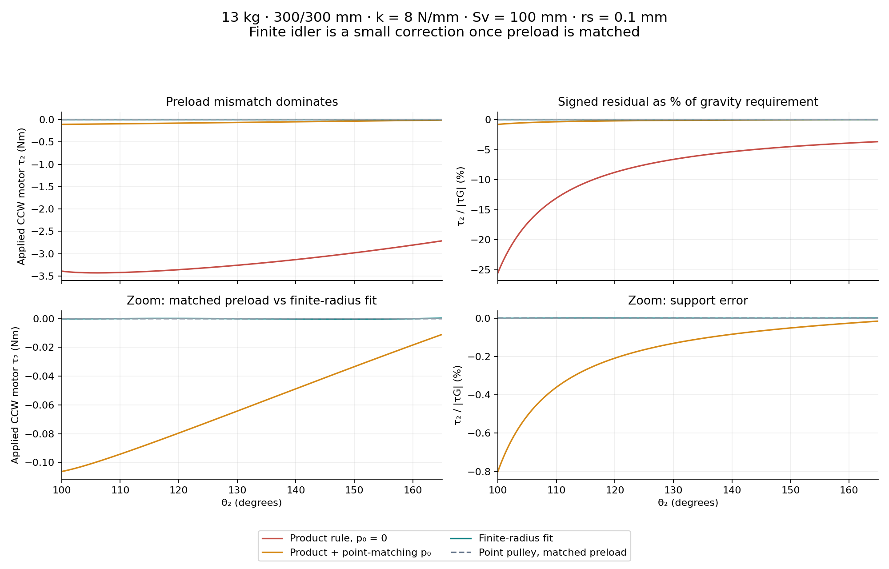

# V4 13kg pulley tuning

Author: Jonathan Xie with Codex. Date: 2026-10-18. Analytical numerical fit;
not a hardware tolerance, spring rating, measured performance or exact-balance proof.

## Confirmed case

The user confirmed equal L2=L3=300 mm, q_ab=2, alpha=phi0=nu=0,
all13 kg in chassis m1, moving masses zero, Fy=0, Fz=13g=127.53 N, beta=0,
k=8 N/mm, Sv=100 mm, rs=0.1 mm and theta2=100–165 degrees.

V4 now uses actual applied CCW motor torque:

```
tauG = +2*m*g*L*cos(theta2)/1000   [L mm; negative in this operating range]
tauS = -Fs*cprime/1000            [physical spring couple; normally CW]
tau2 = tauG-tauS                  [positive CCW / negative CW]
```

## Why the product alone misses

For rs=0, Su=nu=0, define d0=abs(Sv-rh). The literal preload law is
Fs=k*d+(p0-k*d0), while dprime=-rh*Sv*cos(theta2)/d. Therefore:

```
tau2 = (2*m*g*L-k*rh*Sv)*cos(theta2)/1000
       + (p0-k*d0)*dprime/1000
```

Exact cancellation needs TWO conditions: k*rh*Sv=2mgL AND p0=k*d0.
The product sets the scale; preload removes the nonlinear dprime term.
For this case rh=95.6475 mm and matching p0=34.82 N. The rh–Sv mismatch
is4.3525 mm, so the hypothetical90-degree reference is valid at rs=0.1 mm.

A finite idler further changes c: it is tangent length PLUS changing wrap,
not centre distance d. Its exact cprime is the tangent-force moment arm.
Making rs small approaches the point result but does not correct wrong preload.
Relative effects are also sensitive to clearance at the90-degree reference;
0.1 mm is2.30% of this4.3525 mm gap. Finite-radius error is smooth on this
valid taut branch. The former symmetric-log/support presentation and automatic
vertical zoom can make a small residual look more dramatic; a curved residual
is not necessarily a large residual or numerical nonsmoothness. An enabled
driver can also undo fitted rh/k/Sv, and changing mass alone does not update Fz.

## Results over100–165 degrees

| Setup | Su (mm) | rh (mm) | p0 (N) | Peak absolute motor (Nm) | Max absolute motor / abs(tauG) |
| --- | ---: | ---: | ---: | ---: | ---: |
| Product only, no preload | 0 | 95.6475 | 0 | 3.42940 | 25.51484% |
| Product + point preload, rs0.1 | 0 | 95.6475 | 34.82 | 0.106332 | 0.800255% |
| Finite-radius fit, rs0.1 | 0.0495235514 | 95.5636321098 | 36.3389792098 | 0.000290116 | 0.000392529% |
| Point limit, matched preload, rs0 | 0 | 95.6475 | 34.82 | <5e-14 | <7e-14% |

The finite-radius fitted equivalent support is0.9999960747–1.0000039252 mg,
or approximately127.53 N ±0.000501 N. pe=141.10196 N; maxFs=953.27244 N;
the100–165-degree spring stroke is about101.52 mm for an inextensible cable.
This precision is a property of the ideal mathematical fit. Real geometry,
stiffness, friction and preload tolerances will dominate it.

Load [fitted preset](v4-sample-13kg-fitted.json) using Load parameters, or compare
[product-rule preset](v4-sample-13kg-point-rule.json). Both have all three spring
drivers OFF. Keep them off for the fitted case: its product is76450.906 Nmm,
slightly below the point-rule76518 Nmm; enforcing that nominal rule would undo
part of the finite-radius correction. All other values are explicitly saved.



## Reproduction and limits

Run `python tune-pulley-sample.py` with NumPy/SciPy/Matplotlib to recreate
[compact evidence](v4-tuning.json) and the plot. A least-squares start followed
by constrained SLSQP minimizes maximum absolute tau2/abs(tauG) on1301 uniformly
spaced angles. Declared bounds: Su[-5,5] mm, rh[85,105] mm, p0[0,200] N.
The selected result is checked on65001 angles and independently against the
actual embedded V4 full model on6501 angles per case. This is a local minimax
fit over declared bounds, not a global optimality or exact finite-idler proof.
The same zero-radius model reproduces exact point cancellation to roundoff.

More preload raises tau2 while taut on this branch, with
delta(tau2)=cprime(theta2)*delta(p0)/1000. The increase is angle-dependent;
preload alone generally changes the curve shape. With a wrong p0 the nonlinear
term remains even as rs tends to zero. Slack creates a genuine slope change;
route contact or invalid reference geometry must be resolved, not smoothed away.
