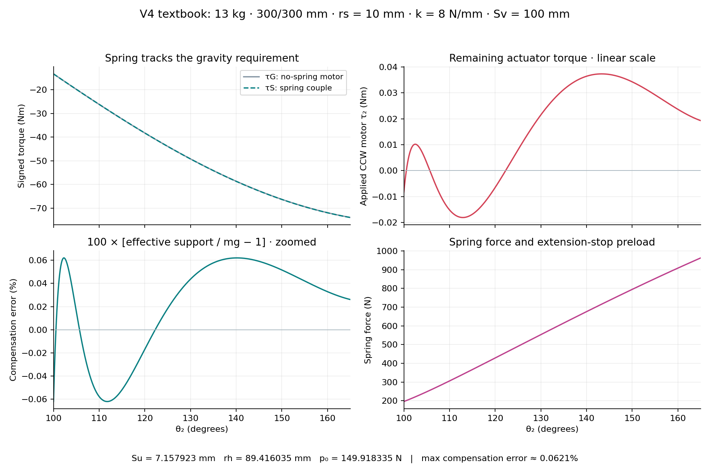

# V4 textbook example — 10mm hip pulley

Author: Jonathan Xie with Codex. Updated2026-10-18. Experimental analytical
fit; no physical tolerance, rating, strength or dynamic validation implied.

## Confirmed inputs and calculated settings

Equal L2=L3=300mm, q_ab=2, alpha=phi0=beta=nu=0, chassis mass13kg with all
moving masses zero, Fy=0, Fz=127.53N, g=9.81, k=8N/mm, Sv=100mm,
rs=10mm, theta2=100–165deg. This is V4's new default and Reset/textbook preset.

| Calculated variable | Value |
| --- | ---: |
| Su | +7.1579230735mm |
| rh | 89.4160351660mm |
| p0, actual force at hypothetical90deg | 149.918334501N |
| pe, force at100deg operating stop | 195.954393852N |
| Max Fs, at165deg | 963.065307336N |
| Spring working stroke | 95.888864mm |
| Minimax compensation-error magnitude | 0.062089750% |
| Peak required motor magnitude | 0.037294803Nm |

The corresponding spring-equivalent support is0.99937910–1.00062090mg,
approximately127.53N ±0.07918N. The90deg pin-to-centre distance is12.777174mm,
so its cable tangent exists for a10mm pulley; the reference has2.777174mm
radial clearance. Normal travel begins at100deg. All three nominal drivers
are OFF so they do not overwrite the fitted geometry.

Use [Load parameters preset](v4-textbook-10mm.json), the new Textbook button,
or Reset. These parameter files save the entire confirmed case, including Fz;
changing mass alone still does not silently change prescribed contact forces.



## What the percentage now means

The owner clarified that the desired percentage is effective mg compensation,
not motor torque divided by tauG. V4 now uses:

```
Jz = dzC/dtheta2                    [mm/rad]
Feq = -tauS/(Jz/1000)              [spring-equivalent vertical support, N]
compensation error = 100*(Feq/(m_total*g)-1)   [%]
```

Thus0%=1mg, -10%=0.9mg and+10%=1.1mg. The compensation plot is linear,
initially spanning at least-10%..+10% and expanding for larger errors. Raw
applied motor tau2 is plotted separately in linear Nm. Headline brackets now
show compensation error labeled `% mg`; global brackets use the torque-peak
pose, not a separately maximized compensation error. Both mass normalization
and zero vertical Jacobian are explicitly undefined when their denominator is
zero. Changing Fz does not change the spring-only support curve. With general
loads/moving masses the compensation percentage is not the motor residual
divided by tauG; only the confirmed ideal case makes those quantities coincide.

## Exact point rule versus finite fitting

For rs=0, Su=nu=0, equal links/q_ab2 and the stated ideal loading, two exact
conditions are k*rh*Sv=2mgL*cos(alpha) and p0=k*abs(Sv-rh).
The existing driven k/rh/Sv checkboxes enforce only the first condition;
the point-preload button sets the second. These are coupled requirements,
not independent choices. P0=0 only matches the point rule if rh=Sv.

For a finite pulley, payout c includes the tangent span plus changing wrap.
The spring force is p0+k[c(theta)-c(90)] while taut, and the physical spring
couple is tauS=-Fs*cprime/1000. Offset Su changes the moment arm and phase.
The nominal point product and point preload therefore do not solve the full
finite problem. In particular, the old point result rh95.6475,Su0 puts the
90deg pin only4.3525mm from S: a10mm pulley has no tangent there. The literal
preload-reference guard is retained, as explicitly chosen by the owner.

No exact finite-pulley closed-form matching identity is established here.
The new **Fit rh,Su,p0 to1mg** button is an explicit numerical alternative:
it holds k,Sv,rs,nu and leg geometry fixed, varies rh/Su/p0 together, turns off
the nominal critical drivers, and reports the checked error. P0 and Su are
therefore solved design outputs for that fit, but not uniquely defined live
driven variables without an objective and travel window. Refit after changing
held values, total weight, mounting angle or travel. The point button remains
a clearly labeled ideal-limit reference for finite geometries.

## Numerical method and checks

Run `python tune-pulley-textbook.py` with NumPy/SciPy/Matplotlib to regenerate
[compact evidence](v4-textbook-verification.json) and the scientific plot.
Seven least-squares starts lead to a common basin; constrained SLSQP then
minimizes maximum compensation error on1001 angles. Declared bounds:
Su[-60,60]mm, rh[20,180]mm, p0[0,3000]N. A65001-angle sweep checks the result;
6501 actual embedded-solver poses independently reproduce its metrics.
This is a bounded sampled local minimax fit, not a global optimality or exact
finite-pulley proof. Friction and manufacturing/stiffness tolerances are absent.

The browser's dependency-free fitter uses affine Chebyshev interval feasibility
to eliminate p0 for each rh/Su pair, then multistart 2D Nelder-Mead on181 angles,
with6501 full-model verification poses. Its automatic rh/Su/p0 bounds are
returned with the result. For this sample it achieves about0.06219% checked
error, near the denser SciPy reference0.06209%; it does not claim a certified
continuous-domain bound. Fit failures leave the previous valid configuration.

The [0.1mm comparison](v4-tuning.md) remains available. That smaller-pulley fit
reaches0.00039253% in the ideal model; increasing radius to10mm still permits
the compact one-spring mechanism to match support closely after joint tuning.
